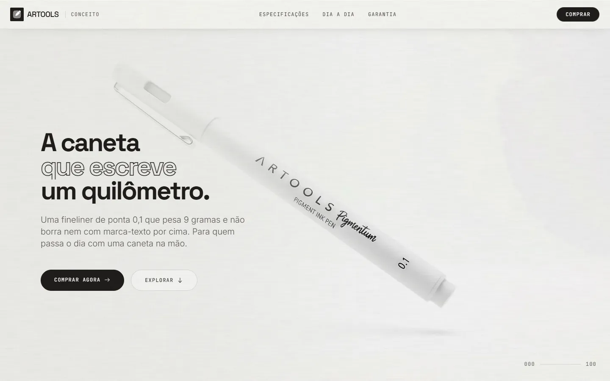

# Artools · Pigmentum

Landing page de produto para a caneta Artools Pigmentum. O vídeo do topo avança conforme a pessoa rola a página, e o modo técnico mostra as peças internas da caneta com medidas.



## Links

| | |
| --- | --- |
| Site | https://portfoliozitomenezes.vercel.app/artools/ |
| Estudo de caso | https://portfoliozitomenezes.vercel.app/estudo-de-caso-artools.html |

## Sobre o projeto

Os frames do vídeo do topo são desenhados num `<canvas>` e avançam com a rolagem (GSAP e ScrollTrigger). Assim a página não precisa buscar `video.currentTime` a cada evento de scroll, que é o que costuma travar esse tipo de animação. As seções seguintes entram com animação, e a seção de fluxo tem um vídeo em loop. O design system da página está documentado em `design_system.html`.

## Estrutura

```
.
├── index.html                # Landing page
├── design_system.html        # Cores, tipografia e componentes
└── assets/
    ├── video/                # hero.mp4 (scroll do topo) e flow.mp4 (seção de fluxo)
    └── ds/                   # Fontes (Inter) e imagens do design system
```

## Como rodar

Não tem build nem dependências. Sirva a pasta (os vídeos não carregam direito abrindo o arquivo direto):

```bash
npx serve .
# ou
python -m http.server 8000
```

A versão publicada fica na pasta `artools/` do repositório do portfólio.

## Ferramentas

HTML, Tailwind CSS, GSAP com ScrollTrigger e Iconify. Claude ajudou no código e nos textos.

## Status

Publicado como parte do portfólio. Ainda não passou por teste com usuários.

## Autor

Antonio Zito · [Portfólio](https://portfoliozitomenezes.vercel.app) · [LinkedIn](https://www.linkedin.com/in/antonio-zito-4b64b71b0) · [Behance](https://www.behance.net/antoniozitome)

© 2026 Antonio Zito. O código pode ser consultado; textos, imagens e marca não podem ser reutilizados sem autorização.
